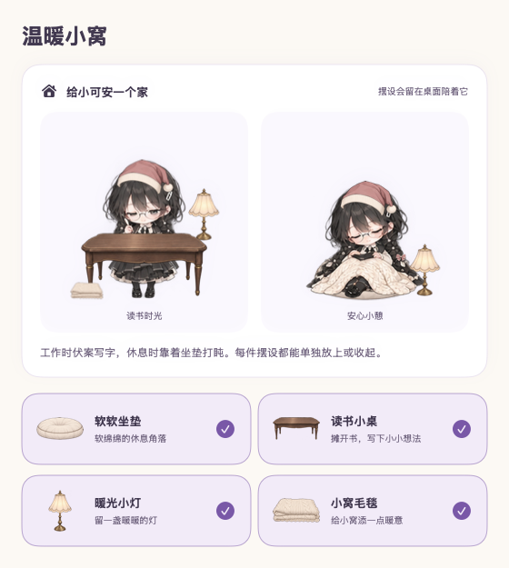
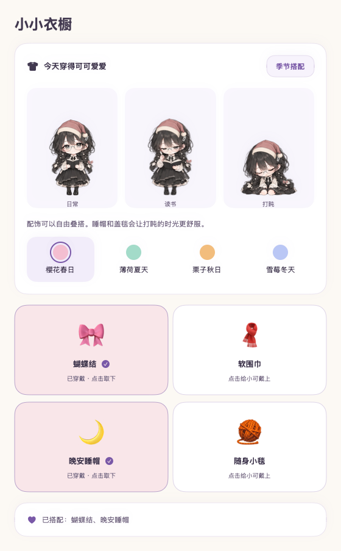
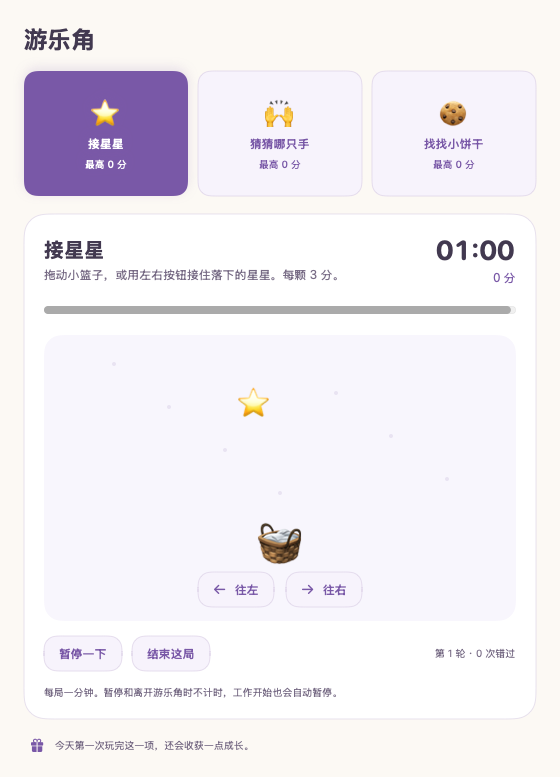

# 小可 XiaoKe

**让 Agent 工作时，桌面上有人陪你。**

小可是一个 macOS 桌面伴侣：Agent 工作时翻书写字，空闲时低头打盹；任务完成、出错或等待输入时，用气泡告诉你。支持 **Codex 自动监听、Claude Code Hooks、任意命令行 Agent 和自定义事件接入**。

[下载安装包](https://github.com/jsczymm1015/xiaoke/releases/latest) · [详细安装](docs/INSTALL.md) · [Agent 接入](docs/AGENTS.md) · [贡献指南](CONTRIBUTING.md)

> 当前版本：0.4.0。支持 **Apple Silicon Mac / macOS 13+**。Windows、Linux、Intel Mac 暂未提供发布包。应用使用本地临时签名，**尚未经过 Apple Developer ID 签名或公证**。

## 看看小可

以下为真实 AppKit / SwiftUI 渲染截图，使用隔离的演示数据，不包含个人任务或存档。

| 工作时写字 | 空闲时打盹 |
|---|---|
|  |  |



| 衣橱搭配 | 一分钟小游戏 |
|---|---|
|  |  |

## 安装：不需要编译

1. 到 [Releases](https://github.com/jsczymm1015/xiaoke/releases/latest) 下载 `xiaoke-0.4.0-macos-arm64.zip`。
2. 解压，把 **小可桌宠.app** 拖到「应用程序」。
3. 打开小可。若 macOS 因未公证阻止打开，先确认下载来源和发布页校验值，再到「系统设置 → 隐私与安全性」按 macOS 的提示允许此应用。不要全局关闭 Gatekeeper。
4. 双击角色打开面板；右键打开喂养、小窝、衣橱、硬件等入口。菜单栏 **「可」** 可以找回角色、恢复鼠标互动和退出。

仅使用桌宠和 Codex 自动监听，无需 Python、API Key 或额外付费服务。接入其他 Agent 需安装下方桥接命令，依赖 Python 3.9+。

### 安装桥接命令

先确认 `python3 --version` 可用；没有 Python 时可从 [python.org](https://www.python.org/downloads/macos/) 安装，或使用自己已有的包管理器。

```sh
mkdir -p "$HOME/.local/bin"
cp '/Applications/小可桌宠.app/Contents/Resources/cli/xiaoke' "$HOME/.local/bin/xiaoke"
chmod +x "$HOME/.local/bin/xiaoke"
export PATH="$HOME/.local/bin:$PATH"
xiaoke doctor
```

把 `export PATH="$HOME/.local/bin:$PATH"` 加入 `~/.zshrc`，新终端也能使用。桥接脚本只依赖 Python 标准库，不需要 `pip install`。

## 接入你的 Agent

| Agent / 场景 | 最短路径 | 能看到什么 |
|---|---|---|
| 本机 Codex | 打开小可即可，设置中开启 Agent 任务提醒 | 回合开始/结束、可识别阶段、计划步骤 |
| Claude Code | 在项目目录运行 `xiaoke install-claude`，重启 Claude Code | 提交任务、工具运行、等待审批、回合结束 |
| 任意 CLI | `xiaoke run --provider my-agent -- agent-command` | 进程开始、运行、退出成功/失败/中断 |
| 自研 Agent | `xiaoke event ...` 或写 v1 原子事件文件 | 自定义标题、阶段、等待输入、步骤进度 |

### Claude Code

```sh
cd /path/to/your/project
xiaoke install-claude
```

默认合并到当前项目的 `.claude/settings.local.json`，保留已有 Hooks 和其他设置，修改前备份。要应用到所有项目：

```sh
xiaoke install-claude --settings "$HOME/.claude/settings.json"
```

重新启动 Claude Code。具体事件映射、卸载方式、权限与版本限制见 [接入文档](docs/AGENTS.md#claude-code)。不要在同一 Claude Code 会话同时开启 Hooks 和命令行包装，否则会显示两条任务。

### 任意命令行 Agent

```sh
xiaoke run --provider my-agent --title '整理项目' -- agent-command --your-option
```

`agent-command` 替换成你已有的 Agent 命令。小可保留输入输出和退出码，不截取正文，不调用模型。包装常驻交互 CLI 时，“完成”指**进程退出**；要区分里面的每轮对话，应使用 Hooks 或事件接口。

先做一个无需任何 Agent 的小测试：

```sh
xiaoke run --provider demo --title '连接测试' -- python3 -c 'import time; time.sleep(8)'
```

### 自定义事件

```sh
xiaoke event started --provider my-agent --task example --title '检查项目'
xiaoke event progress --provider my-agent --task example --title '检查项目' --phase reviewing --completed 2 --total 3
xiaoke event waiting --provider my-agent --task example --title '需要确认'
xiaoke event completed --provider my-agent --task example --title '检查项目'
```

长任务需要定期上报；CLI 包装器每 10 秒自动刷新。没有刷新且超过有效期的任务会退出忙碌列表，**不会被当成成功**。完整协议见 [docs/AGENTS.md](docs/AGENTS.md)。

## 0.4.0 动作一致性

站立也已同步为统一角色素材，拖动、松手、吃喝和工作不再混用旧图集；移除拖动缩小与身体拉伸。详见[动作联系表与生成记录](docs/artwork/README.md)和[验证记录](docs/VALIDATION-0.4.0.md)。

## 不只是状态灯

- **陪伴**：写字、翻页、低头打盹、触摸头/脸/书、拖动抱起、放下。
- **养成**：食物、饮品、饱腹、精力、好感、心情、偏好与成长。
- **小窝与衣橱**：坐垫、书桌、暖灯、毛毯；四季配饰和真实穿戴预览。
- **小游戏**：接星星、猜哪只手、找饼干；工作时暂停。
- **工作生活**：待办、便签、习惯、专注计时、快捷入口、久坐提醒。
- **硬件**：右键选择查看温度、电池、可用功率/风扇读数，不悬停弹窗。
- **文件助手**：可选功能，仍专门使用已安装并登录的 Codex；需在界面明确允许发送所选内容。

## 隐私与兼容性

通用接入使用当前用户私有目录下的原子 JSON 文件，**没有网络监听端口**。仅处理你主动上报的标题、状态、任务标识和步骤数；不要把秘密放在标题里。Codex 适配器只读本机记录，保留生命周期和进度元数据，不修改 Codex 配置。

待办、养成和设置保存在 `~/Library/Application Support/XiaoKeCompanion/`。从“小柯”升级保持同一 bundle ID 和存档目录；无需迁移。关闭旧应用后再打开新版，避免两份同时运行。

Codex 的本地日志格式可能变化；云端任务、远程机器上的任务需要在本机转发事件。本版本不提供远程连接、账号同步、通用文件助手或总体任务完成百分比。系统通知默认关闭，可自行开启；提醒受免打扰控制。

## 从源码构建

需要 Apple Silicon Mac、macOS 13+、Xcode Command Line Tools、Python 3.9+ 和 Git。

```sh
xcode-select --install  # 已安装则跳过
git clone https://github.com/jsczymm1015/xiaoke.git
cd xiaoke
/bin/zsh scripts/build.sh
open 'dist/小可桌宠.app'
```

`build.sh` 先跑自动测试，再编译和本地签名。输出为 `dist/小可桌宠.app`。详细开发与测试说明见 [CONTRIBUTING.md](CONTRIBUTING.md)。

## 测试范围

包含核心逻辑、存档迁移、养成、小游戏、文件助手、硬件格式、窗口定位、运行诊断、Codex 日志解析、任务气泡、通用事件协议和 CLI 自动测试。图形会话中还可运行原生画布与喂养菜单测试。

Claude Code Hooks 已通过模拟载荷与配置合并测试；**真实 Claude Code 会话尚未端到端验证**。命令行包装器和桌面事件接入单独验证。其他机型的真实传感器、长期待机、系统通知授权没有完整覆盖。

## 许可证与素材

代码采用 [MIT](LICENSE)。角色与家具的生成来源、素材使用边界见 [ASSETS.md](ASSETS.md)。本项目是独立社区工具，不代表 OpenAI、Anthropic 或其他 Agent 厂商。
