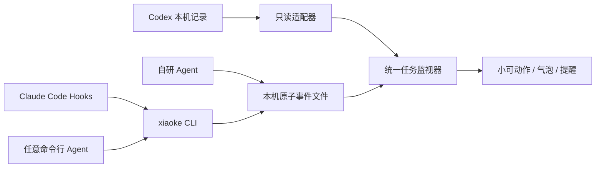

# Agent 接入开发文档

## 架构



不运行 HTTP 服务，不需要 API Key。通用接入目录为 `~/Library/Application Support/XiaoKeCompanion/agent-inbox/`，CLI 创建为 `0700`，事件文件为 `0600`。同一用户下的进程可以读写它，因此这不是针对同一用户恶意程序的安全隔离边界。

应用和 CLI 均可用 `XIAOKE_DATA_DIR` 指定隔离数据根目录；仅在开发测试时使用，二者必须一致。正常 Finder 启动不会继承终端临时环境变量。

## Codex

自动只读 `~/.codex/sessions` 下的本地生命周期记录，使用 `session_index.jsonl` 的标题元数据。不会写 Codex 的 Hooks、notify、账号或信任配置。后台约 2 秒读取已发现文件，约 10 秒发现新文件。过滤已识别的子代理、guardian 和自动化回合。

这是本地格式适配器，不是稳定公开的订阅 API；纯云端任务和后续格式变化可能无法观察。无明确计划时显示流动忙碌条，不能推测总体完成百分比。首次启动基线和有界恢复不会补发历史完成提醒。

## Claude Code

```sh
xiaoke install-claude                       # 当前项目 .claude/settings.local.json
xiaoke install-claude --settings "$HOME/.claude/settings.json"  # 所有项目
```

安装器合并现有 JSON，保留其他配置；格式非法时不覆盖。已有文件先复制为 `settings.json.xiaoke-backup-<随机值>` 等名称。同一安装路径重复运行不重复添加 Hooks。命令固定为当前 Python 解释器和脚本的绝对路径，并做 shell 引号转义；移动脚本或卸载 Python 后应重新安装并移除旧条目。

| Claude Code Hook | 小可状态 |
|---|---|
| `UserPromptSubmit` | started |
| `PreToolUse` | progress |
| `PermissionRequest` | waiting |
| `Stop` | completed |
| `SessionEnd` | interrupted（会话关闭，不额外声称成功） |

输入仅用于取 `session_id` 与 `hook_event_name`。会话 ID 做 SHA-256 截断，显示固定标题，不保留 prompt、transcript_path 或工具输入。每会话一个活动任务；多会话可同时显示。等待审批后下一次工具调用会恢复运行状态。

Hooks 有效期为最后一次事件后 1 小时；过期只移除状态。长时间没有 Hook 的纯思考回合可能过期。`Stop` 代表 Agent 回合停止，不代表测试通过；其他 Hooks 阻止停止时，下一次事件会恢复活动状态。不同 Claude Code 版本的事件支持可能变化，安装后需重启并自行检查 Hooks。实际 Claude Code 会话尚未端到端验证。

卸载：只移除配置中 `xiaoke hook claude-code` 对应的 command 项，保留同事件下的其他 Hooks。不要盲目用旧备份覆盖后续新增配置。

## CLI 包装

```sh
xiaoke run --provider my-agent --title '我的任务' -- executable arg1 arg2
```

不使用 shell 拼接，不读取输出。保留标准输入/输出/错误与退出码；转发 SIGINT/SIGTERM 给子进程，非零退出为 failed，信号退出为 interrupted。每 10 秒更新一次，TTL 45 秒。强制杀死包装器后，活动状态会自然过期；不会杀掉任意进程组或承诺清理 Agent 自己派生的所有后台进程。

`--provider` 用于区分工具，`--task` 可指定任务标识（默认 UUID）。不要对并发任务复用同一 provider/task。默认标题只含 provider，不包含完整命令或参数。进程成功退出不保证业务成功。对于常驻交互式 Agent，建议实现每回合 Hooks。

## 事件 CLI

```sh
xiaoke event started --provider example --task task-1 --title '整理文档'
xiaoke event progress --provider example --task task-1 --title '整理文档' --phase editing --completed 1 --total 4
xiaoke event waiting --provider example --task task-1 --title '等待确认' --ttl 3600
xiaoke event completed --provider example --task task-1 --title '整理文档'
# 其他终态：failed、interrupted
```

每次事件应携带所需标题和步骤数；它是当前状态快照，不是增量合并。单次 CLI 默认 TTL 为 45 秒；长任务每 10–15 秒发 progress，或显式指定合理 TTL（5–86400 秒）。快速任务可能只显示完成提醒，没有足够时间播放开始动作。

## v1 文件协议（不依赖 Python）

可自行实现一个写文件的适配器。文件名为 `SHA256(provider + NUL + taskID).json`；用同目录临时文件写完后原子 rename，避免读取到半个 JSON。一个任务只保留最新快照。

```json
{
  "version": 1,
  "eventID": "b38dbf94-9387-435c-99bc-b8251cdd28d0",
  "provider": "example",
  "taskID": "task-1",
  "status": "progress",
  "title": "整理文档",
  "timestamp": 1793174400,
  "ttl": 45,
  "phase": "editing",
  "completed": 1,
  "total": 4
}
```

上例 timestamp 仅示意，必须填当前 Unix 秒数。协议要求：

- `version` 固定 1；每次写入新的 `eventID`。
- provider/taskID/eventID：1–128 个 ASCII 字母、数字、`_`、`-`、`.`。
- status：started/progress/waiting/completed/failed/interrupted。
- title：至多 120 字符，无控制字符；不要写密码、提示词或文件正文。
- timestamp：Unix 秒数；最多允许未来 30 秒时钟偏差。
- ttl：5–86400 秒；过期移除但不生成完成事件。
- phase 可空：thinking/planning/executing/editing/searching/waiting/reviewing。
- completed/total 可空：必须同时合法，`0 <= completed <= total <= 10000` 且 total > 0。
- UTF-8 JSON 最大 4096 字节；符号链接、未知版本、畸形文件被忽略。
- 读取器每轮最多处理按文件名排序的 256 个文件。CLI 清理修改时间超过 48 小时的旧事件；自研适配器也应清理过期文件。
- 应用重启时恢复有效活动快照，不补发重启前的完成提醒。暂停/重新开启任务提醒采用相同基线。

每个 provider/task 只有一个写入者；不同写入者覆盖同一文件时以最后原子替换为准。协议不提供跨机器排序或远程可靠队列。

## 新适配器贡献要求

提供：接入说明、脱敏事件样例、开始/等待/完成/失败/中断映射、退出与超时行为、去重策略和测试。不要提交真实聊天记录、账号配置或 API Key。优先使用厂商公开 Hooks；只能读内部日志时应明确格式和限制。
