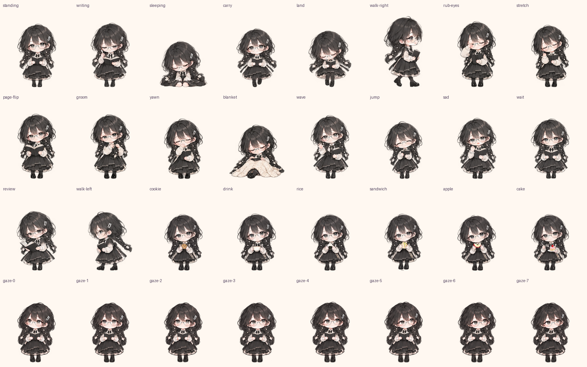

# 0.4.0 统一人物素材

使用内置 imagegen 以同一小馆员身份生成整套动作，源图在 `../../artwork/unified/`，对应提示词保存在本目录。5 张源图共 160 帧（core/daily/emotes/foods 各 36 帧，gaze 16 帧）。为兼容原图集布局，部分循环均匀重复帧以达到旧布局的帧数。

打包只进行透明间隙裁切、每行固定的等比例缩放和脚底对齐，不进行头身分段拉伸。头部尺寸按统一 100px 目标测量；手臂伸入头部测量区、头发摆动与转头会影响轮廓宽度，数值详见 measurements.json。坐下时保留头部尺寸，身体自然变矮。

运行时彻底移除旧 socialFrame 头身重映射。拖动不缩小，落地不压扁；各状态共用用户设置的 scale 和 192×208 画布。白龙外观保持自己的独立素材。

